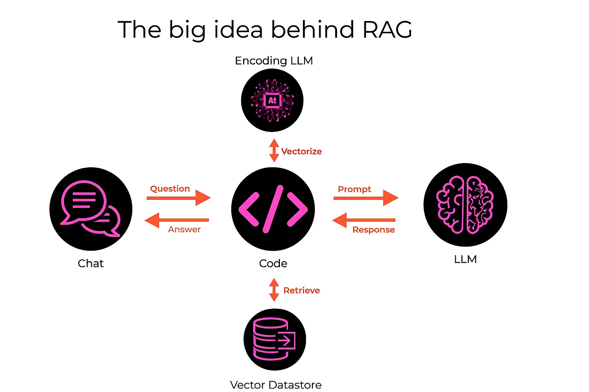
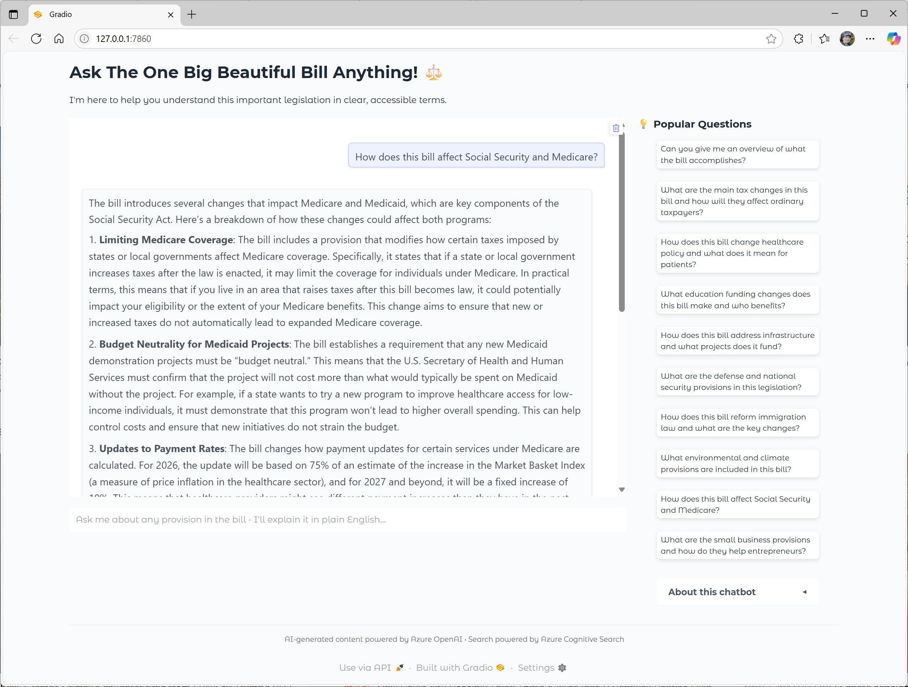

# Readless: Lets RAG our Legislation!

## 1. Overview

This project provides an interactive way to explore and understand complex legislation through a polished, user-friendly chatbot interface. The application uses Retrieval Augmented Generation (RAG) to allow users to quickly understand provisions of "The One Big Beautiful Bill," ask specific questions, and explore its implications in plain language. The chatbot is designed to translate complex legal language into clear, accessible terms that anyone can understand, making legislation more approachable.

The technical foundation of this project is a sophisticated RAG system with several key components: a data processing pipeline that chunks and vectorizes the bill text, Azure Cognitive Search for efficient similarity searching of these embeddings, and Azure OpenAI's language models that generate clear, accessible explanations based on the retrieved context from the bill.

## 2. What is RAG anyway?

Retrieval Augmented Generation (RAG) is a technique used to enhance the responses of Large Language Models (LLMs) by grounding them in specific, external knowledge. LLMs, while powerful, are trained on vast but general datasets, and their knowledge is fixed at the time of training. This means they might not have information on very specific, niche, or very recent topics, or they might sometimes generate plausible-sounding but incorrect information (a phenomenon known as "hallucination").

RAG addresses this by connecting the LLM to an external knowledge base. Here's a breakdown of a typical RAG process:

1.  **User Input:** The user enters a question or prompt into the chatbot or application.
2.  **Query Vectorization:** The user's input (question) is converted into a numerical representation called a vector embedding. This is typically done using an embedding model, such as Azure OpenAI's text-embedding-ada-002 or other sentence transformers.
3.  **Context Retrieval:** The vectorized question is then used to search a specialized database (Azure Cognitive Search) that contains pre-processed chunks of text from the knowledge base (in this case, the bill text) and their corresponding embeddings. The system retrieves the text chunks whose embeddings are most similar to the question's embedding.
4.  **Prompt Augmentation:** The original user question and the retrieved relevant text chunks (the "context") are combined into a new, augmented prompt. This prompt is then passed to the LLM.
5.  **LLM Response Generation:** The Azure OpenAI language model uses the provided context from the retrieved chunks to generate an informed and relevant answer to the user's original question, explaining complex legal concepts in plain language.
6.  **Output to User:** The LLM's response is then passed back to the user through the chatbot interface.

Below is a visual representation of this RAG process:




This approach is crucial because it allows LLMs to provide more accurate, up-to-date, and contextually relevant responses, significantly reducing hallucinations and making them more reliable for specific domains or custom datasets.

## 3. Features

The Ask-a-Bill-Anything Chatbot includes several refined features:

- **Modern, Intuitive Interface:** Clean UI with a clear chat window and organized sidebar navigation
- **Responsive Visual Feedback:** Animated "breathing" dots provide real-time processing feedback
- **Interactive Popular Questions:** Clickable sidebar with pre-loaded sample questions for quick exploration
- **Accessible Explanations:** Complex legal language translated into clear, everyday terms
- **Clean Typography:** Sans-serif fonts make chat dialog easy to read and visually distinct
- **Compact Information Panel:** Collapsible "About" section in the sidebar provides context without clutter
- **Professional Attribution:** Subtle Azure OpenAI attribution tagline at the bottom of the interface
- **Responsive Design:** Well-organized layout that works across different screen sizes
- **Accurate Responses:** All answers are grounded in the actual bill text, not general knowledge



The application consists of three main Python files:

**Script 1: `fetch_doc.py`**
- Handles document acquisition and text extraction
- Robustly fetches bill text from Congress.gov using multiple fallback methods
- Processes and cleans raw HTML into usable plain text

**Script 2: `process_doc_azure.py`**
- Loads the bill text and splits it into semantic chunks
- Creates vector embeddings using Azure OpenAI's embedding model
- Stores these embeddings in an Azure Cognitive Search index for efficient retrieval and scalable search

**Script 3: `rag_chatbot.py`**
- Creates a polished Gradio-based web interface for interacting with the bill
- Implements a RAG pipeline using LangChain and Azure OpenAI's language models
- Features immediate user feedback with animated processing indicators
- Background thread management for responsive UI during processing
- Consistent bill terminology throughout the interface and responses

### Key Technologies Used:

*   **Langchain:** Langchain is an open-source framework designed to simplify the development of applications powered by large language models (LLMs). It provides tools and abstractions for managing prompts, chaining LLM calls, integrating with external data sources (like vector stores), and creating agents. In this project, Langchain is used for text splitting, managing the Azure OpenAI language model, creating embeddings, and orchestrating the RetrievalQA chain which forms the core of the RAG system. The carefully crafted prompt template ensures consistent, clear responses focused on the bill's content.

*   **Azure Cognitive Search:** Azure Cognitive Search is a cloud-based search service that provides rich search capabilities over diverse content types. With built-in AI capabilities and vector search functionality, it serves as the vector database for this project. After splitting the bill text into chunks and creating embeddings for each chunk using Azure OpenAI, the service stores these embeddings and enables fast similarity searches. When a user asks a question, the RAG system queries Azure Cognitive Search to find the most relevant text chunks from the bill to provide as context to the LLM.

*   **Azure OpenAI:** Azure OpenAI provides access to OpenAI's advanced language models through Microsoft's secure, enterprise-ready cloud platform. The project uses two main Azure OpenAI services: the text-embedding-ada-002 model for creating vector embeddings of the bill text, and GPT-4o-mini for generating conversational responses. Azure OpenAI offers enhanced security, compliance, and reliability compared to direct OpenAI API access, making it suitable for enterprise deployments.

*   **Gradio:** Gradio provides the web interface framework that makes the chatbot accessible through a browser. The implementation includes custom CSS styling, responsive layout with appropriate column scaling, and interactive elements like the clickable sidebar questions and the compact "About" accordion. Custom font settings create visual hierarchy and improve readability throughout the interface.

*   **Threading:** Background threading is implemented for a responsive UI experience, allowing the application to show animated feedback while the LLM processes queries in parallel. This prevents UI freezing during processing and provides immediate visual feedback through the animated "breathing" dots pattern that expands and contracts while the system analyzes the query.

## 4. Setup

To set up the project environment and install all necessary dependencies, run the following command in your terminal:

```bash
pip install -r requirements.txt
```

**Note on API Keys:**

You will need to set up Azure OpenAI and Azure Cognitive Search services and configure their API keys. There are a few ways to do this:

1.  **Environment Variables (Recommended for Production/Sharing):**
    Set them directly in your shell. This is good for temporary sessions or server environments.
    *   PowerShell:
        ```powershell
        $Env:AZURE_OPENAI_API_KEY='your_azure_openai_api_key_here'
        $Env:AZURE_OPENAI_ENDPOINT='https://your-resource.openai.azure.com/'
        $Env:AZURE_SEARCH_SERVICE_ENDPOINT='https://your-search-service.search.windows.net'
        $Env:AZURE_SEARCH_API_KEY='your_search_api_key_here'
        ```
    *   Bash/Zsh:
        ```bash
        export AZURE_OPENAI_API_KEY='your_azure_openai_api_key_here'
        export AZURE_OPENAI_ENDPOINT='https://your-resource.openai.azure.com/'
        export AZURE_SEARCH_SERVICE_ENDPOINT='https://your-search-service.search.windows.net'
        export AZURE_SEARCH_API_KEY='your_search_api_key_here'
        ```

2.  **.env File (Recommended for Local Development):**
    Create a file named `.env` in the root directory of the project using the provided `.env.example` as a template.
    Add your Azure credentials to this file:
    ```
    AZURE_OPENAI_API_KEY=your_azure_openai_api_key_here
    AZURE_OPENAI_ENDPOINT=https://your-resource.openai.azure.com/
    AZURE_SEARCH_SERVICE_ENDPOINT=https://your-search-service.search.windows.net
    AZURE_SEARCH_API_KEY=your_search_api_key_here
    ```

    **IMPORTANT SECURITY NOTE:** Never commit your `.env` file or your API keys directly into your version control system (like Git). The provided `.gitignore` file in this project is already configured to ignore `.env` files, preventing accidental check-ins of sensitive credentials.

## 4.1. Project Files

The project includes several scripts and utilities:

### Core Application Files
- **`rag_chatbot.py`**: Main chatbot interface with Gradio UI
- **`process_doc_azure.py`**: Document processing and Azure Cognitive Search index creation
- **`fetch_doc.py`**: Document fetching utilities (if needed for different sources)

### Utility Scripts
- **`check_indices.py`**: Lists all Azure Cognitive Search indices and their document counts
- **`test_deployments.py`**: Tests Azure OpenAI deployments to verify they're working correctly
- **`check_deployments.py`**: Attempts to list Azure OpenAI deployments (may have API limitations)

### Configuration Files
- **`.env`**: Your Azure service credentials (create from `.env.example`)
- **`.env.example`**: Template for environment variables
- **`requirements.txt`**: Python dependencies

### Data Files
- **`books/one_big_beautiful_bill.txt`**: The bill text to be processed

## 5. Running the Application

### Prerequisites

Before running the application, you'll need to set up the following Azure services:

1. **Azure OpenAI Service:**
   - Create an Azure OpenAI resource in your Azure subscription
   - Deploy the following models:
     - `gpt-4o-mini` (or similar) for chat completion - **deployment name must match your config**
     - `text-embedding-ada-002` for embeddings - **deployment name must match your config**
   - Note your endpoint URL and API key

2. **Azure Cognitive Search:**
   - Create an Azure Cognitive Search service
   - Ensure it has vector search capabilities enabled
   - Note your service endpoint and API key

3. **Environment Configuration:**
   - Copy `.env.example` to `.env`
   - Fill in your Azure service credentials

### Important: Deployment Names vs Model Names

When creating deployments in Azure OpenAI Studio, you choose:
- **Model**: The actual AI model (e.g., `gpt-4o-mini`, `text-embedding-ada-002`)
- **Deployment Name**: What you call it in your Azure resource (can be anything)

**Your `.env` file must match your deployment names, not the model names.** For example:
- If you create a deployment named `my-chat-model` using the `gpt-4o-mini` model, set:
  ```
  AZURE_OPENAI_CHAT_DEPLOYMENT=my-chat-model
  ```

### 1. Process the Bill Text

First, process the bill text to create the Azure Cognitive Search index:

```bash
python process_doc_azure.py
```

This script:
- Creates an Azure Cognitive Search index with vector search capabilities
- Loads the bill text from the source file
- Splits the text into semantic chunks
- Creates vector embeddings using Azure OpenAI's embedding model
- Uploads the embeddings to Azure Cognitive Search for efficient retrieval

**Expected output**: The script will create an index with approximately 1,900+ document chunks from the bill text.

### 2. Launch the Chatbot Interface

Once the search index is created, launch the chatbot:

```bash
python rag_chatbot.py
```

This will start a Gradio web interface, typically available at `http://127.0.0.1:7860`.

### Troubleshooting Common Issues

#### 1. "DeploymentNotFound" Error
**Symptoms**: Error 404 with message "The API deployment for this resource does not exist"

**Solution**: 
- Check that your deployment names in `.env` match the actual deployment names in Azure OpenAI Studio
- Use the test script to verify deployments:
  ```bash
  python test_deployments.py
  ```

#### 2. Missing Bill Text File
**Symptoms**: "Error: Text file not found" when running `process_doc_azure.py`

**Solution**: 
- Ensure the bill text file exists at `books/one_big_beautiful_bill.txt`
- If using a different file, update the `TEXT_FILE_PATH` in `process_doc_azure.py`

#### 3. Authentication Issues
**Symptoms**: 401 or 403 errors when accessing Azure services

**Solution**: 
- Verify your API keys are correct and not expired
- Check that your Azure OpenAI resource is active and not suspended
- Ensure your Azure Cognitive Search service is running

#### 4. Check Service Status
Use the provided utility scripts to diagnose issues:

```bash
# Check what indices exist in Azure Cognitive Search
python check_indices.py

# Test if your Azure OpenAI deployments are working
python test_deployments.py
```

### API Version Compatibility

The application uses Azure OpenAI API version `2024-06-01` by default. If you encounter compatibility issues:

1. **Check your Azure OpenAI resource's supported API versions**
2. **Update the version in your `.env` file**:
   ```
   AZURE_OPENAI_API_VERSION=2024-02-01
   ```

Supported versions include:
- `2024-06-01` (recommended)
- `2024-02-01` (stable)
- `2023-12-01-preview` (legacy)

## 6. Deployment Options

### Temporary Public Link (Up to 72 hours)

For quick demos, modify the launch line in `rag_chatbot.py` to:
```python
demo.launch(share=True)
```

This will generate a public URL that stays active for up to 72 hours, perfect for short-term demos and testing.

### Permanent Hosting Options

For permanent deployment, you have several well-tested options:

#### 1. **Hugging Face Spaces** (Recommended)
The simplest deployment option with minimal setup:

1. **Create a GitHub repository** with your code (including all files in this project)
2. **Sign up** for a [Hugging Face](https://huggingface.co/) account if you don't have one
3. **Create a new Space**:
   - Go to [huggingface.co/new-space](https://huggingface.co/new-space)
   - Select "Gradio" as the SDK
   - Choose a name and set visibility (public or private)
4. **Link to your GitHub repository** in the Space settings
5. **Add your Azure credentials** as secrets:
   - In your Space settings → Secrets
   - Add secrets for `AZURE_OPENAI_API_KEY`, `AZURE_OPENAI_ENDPOINT`, `AZURE_SEARCH_SERVICE_ENDPOINT`, and `AZURE_SEARCH_API_KEY`
6. **Set the following build command** in your Space:
   ```bash
   python process_doc_azure.py && python rag_chatbot.py
   ```

#### 2. **Cloud Providers**
For more control and scalability:

- **Azure App Service**:
  - Deploy as a Python Web App
  - Configure startup command to run both processing and chatbot scripts
  - Add Application Settings for Azure OpenAI and Azure Cognitive Search environment variables
  
- **AWS Elastic Beanstalk**:
  - Use the Python platform
  - Configure `.ebextensions` to set up Azure service environment variables
  - Include search index generation in your deployment scripts
  
- **Google Cloud Run**:
  - Create a Dockerfile that sets up the environment
  - Run both scripts in your container startup
  - Set Azure service environment variables in the Cloud Run configuration

#### 3. **Custom Server**
For maximum flexibility:

- Install Python 3.9+ on your server
- Clone your repository or upload the files
- Install dependencies: `pip install -r requirements.txt`
- Set up environment variables for your Azure service credentials
- Run the processing script first: `python process_doc_azure.py`
- Then start the chatbot server: `python rag_chatbot.py`
- Configure a reverse proxy (Nginx/Apache) to expose the Gradio interface
- Consider using systemd, PM2, or similar to keep the service running

**Important Deployment Considerations:**

1. **Security**: Always store your Azure API keys securely as environment variables or secrets
2. **Cost Management**: 
   - Monitor your Azure OpenAI API usage, especially for high-traffic deployments
   - Consider implementing rate limiting for public instances
   - Azure Cognitive Search also has usage-based pricing
3. **Data Handling**:
   - Ensure the search index is either included in your deployment or generated on startup
   - For larger bills, you may need to adjust memory allocation in your hosting environment
4. **Updates**:
   - Set up a deployment pipeline for easy updates when improving the application
   - Consider versioning your search index if the bill text changes
5. **Azure Service Limits**:
   - Be aware of Azure OpenAI rate limits and quotas
   - Monitor Azure Cognitive Search query and storage limits

## 7. Latest Improvements

The application has undergone several enhancements to improve user experience and readability:

### User Interface Refinements
- **Sidebar Layout**: Redesigned with clickable popular questions and a compact information panel
- **Typography**: Updated chat dialogs to use a modern sans-serif font stack for better readability
- **Visual Feedback**: Implemented "breathing" animated dots during processing for better user experience
- **Streamlined Experience**: Removed redundant elements like the "Clear Chat" button and chat window label
- **Attribution**: Added a subtle Azure OpenAI attribution footer separated from the main interface

### Responsiveness Improvements
- **Immediate Feedback**: Questions and "thinking" indicators now appear instantly after submission
- **Background Processing**: Enhanced threading implementation keeps the UI responsive during API calls
- **Animation Logic**: Refined animation patterns create a smoother, more professional feel

### Terminology Consistency
- **Bill References**: Updated all system prompts and sample questions to consistently refer to "the bill"
- **Prompt Engineering**: Refined the system prompt to ensure the LLM follows consistent terminology

### Documentation
- **Comprehensive Deployment**: Added detailed deployment instructions for various hosting options
- **Enhanced Feature Documentation**: More detailed explanations of all app capabilities
- **Technical Details**: Added deeper information about implementation choices and patterns

## 8. Azure Migration

The application has been migrated from OpenAI and Chroma to Azure OpenAI and Azure Cognitive Search for enhanced enterprise capabilities:

### Architecture Improvements
- **Azure OpenAI Integration**: Replaced direct OpenAI API calls with Azure OpenAI service for better security, compliance, and reliability
- **Azure Cognitive Search**: Migrated from local Chroma database to cloud-based Azure Cognitive Search for scalable vector search capabilities
- **Enhanced Security**: Azure services provide enterprise-grade security features and compliance certifications
- **Improved Scalability**: Azure Cognitive Search can handle much larger document collections and higher query volumes

### Migration Benefits
- **Enterprise Ready**: Azure services offer better security, compliance, and enterprise features
- **Scalability**: Azure Cognitive Search provides better performance for large-scale deployments
- **Reliability**: Cloud-based services with built-in redundancy and availability guarantees
- **Integration**: Better integration with other Azure services and Microsoft ecosystem
- **Advanced Features**: Azure Cognitive Search offers semantic search, faceted search, and hybrid search capabilities

### Configuration Changes
- **New Environment Variables**: Updated to use Azure-specific configuration variables
- **Enhanced Documentation**: Added comprehensive setup instructions for Azure services
- **Dual Scripts**: Created `process_doc_azure.py` for Azure-compatible document processing
- **Updated Dependencies**: Replaced Chroma dependencies with Azure Search SDK

### Current Status
The Azure migration is complete and operational:

✅ **Azure Cognitive Search**: Index created successfully with 1,926+ document chunks  
✅ **Azure OpenAI Embeddings**: Working correctly with `text-embedding-ada-002` model  
✅ **Document Processing**: `process_doc_azure.py` successfully processes and uploads bill text  
✅ **Vector Search**: Azure Cognitive Search provides fast, accurate similarity search  
✅ **Utility Scripts**: Added `check_indices.py` and `test_deployments.py` for troubleshooting  

### Troubleshooting Tools
Several utility scripts are provided to help diagnose and resolve common issues:

- **`check_indices.py`**: Lists all Azure Cognitive Search indices and document counts
- **`test_deployments.py`**: Tests Azure OpenAI deployments to verify they're working
- **`check_deployments.py`**: Attempts to list Azure OpenAI deployments (may fail due to API limitations)

### Known Issues and Solutions
1. **Deployment Names**: The most common issue is mismatched deployment names between `.env` configuration and actual Azure OpenAI deployments
2. **API Versions**: Some Azure OpenAI management APIs may not work with certain API versions, but core functionality works correctly
3. **Authentication**: Ensure Azure services are properly configured and API keys are valid

## 9. Conclusion

This Ask-a-Bill-Anything Chatbot demonstrates how RAG technology can make complex legislative documents more accessible to everyone. By combining Azure OpenAI's advanced language models with Azure Cognitive Search's powerful vector search capabilities, it creates a robust, scalable tool for understanding complex legal text in straightforward language.

The application is now ready for enterprise deployment with Azure's cloud infrastructure, providing enhanced security, scalability, and reliability. As legislation continues to grow in complexity, tools like this can play a crucial role in maintaining democratic transparency and informed civic participation.
